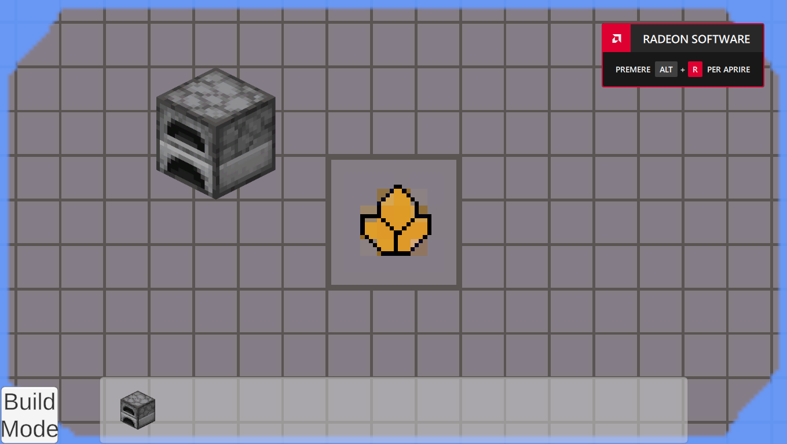
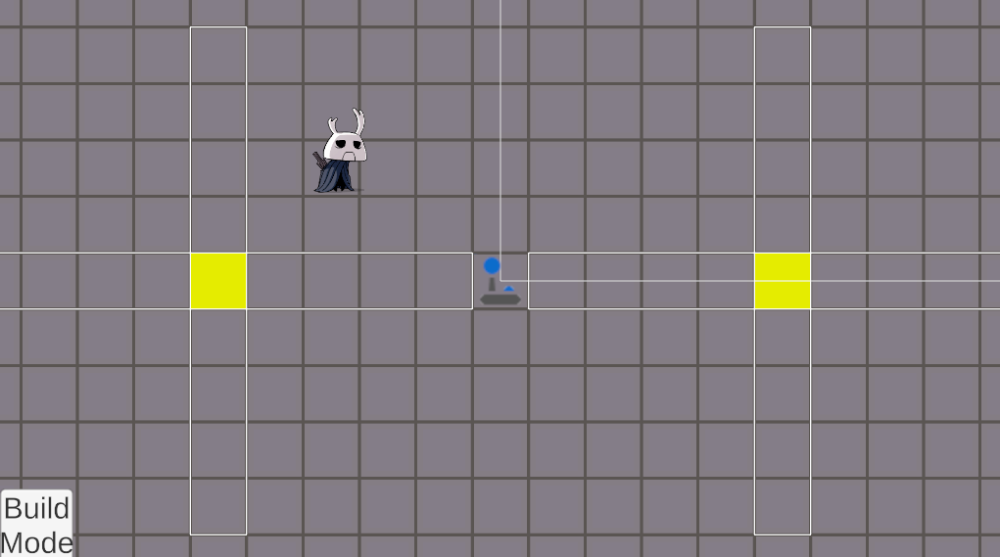
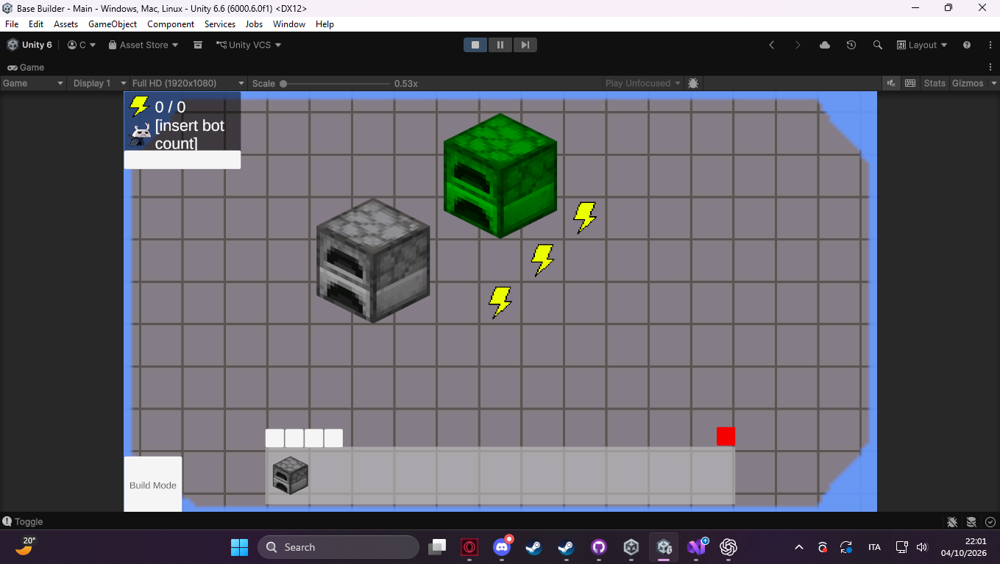
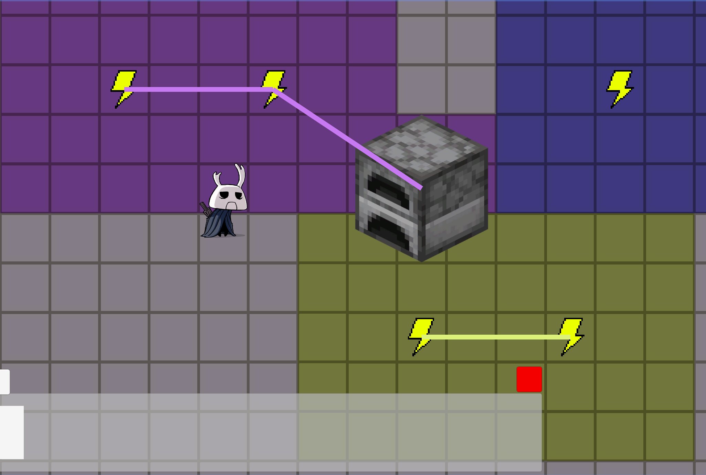
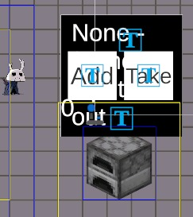
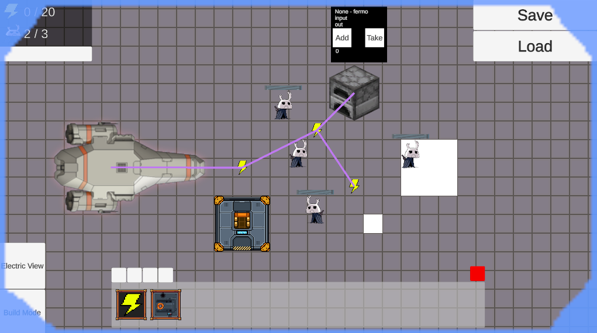

# Base Builder

## Game Description and its mechanics

*Base Builder is a Unity 2D game.you have to build bots that build and mine minerals in order to repair the spaceship.*

## Gallery

# Building your base

*Use build mode to place buildings on the map. Builders can then travel to construction sites and finish the work.*

*Buildings include storage, mineral crates, production machines, generators and power poles. Machines use recipes to turn gathered resources into new materials.*

# Bots

*Bots do most of the work in the outpost.Miners collect resources from mineral nodes, carriers move items between buildings, builders complete construction sites, and workers operate machines.*

*Bots move around the grid and need power to keep working.*

# Power system

*Generators produce power for your base. Use power poles to create a power network and supply machines*

# Tech tree

*The tech tree lets you spend resources to unlock recipes and progress to new buildings.*

# Spaceship

*The spaceship is the main objective of the game. Build up your base and produce the parts needed to repair it.*

# Controls

* **WASD:** *Move the player.*
* **E:** *Interact with a nearby object.*
* **Tab:** *Open the inventory.*
* **Escape:** *Pause the game.*
* **Mouse wheel:** *Zoom in and out.*
* **Build mode:** *Choose a building, then left-click to place it. Use the destroy option to remove a building.*

# How to Install

visit the [Page](https://blackhole-studio.itch.io/base-builder) and then install "Week 8" build,then unzip the folder and run "Base Builder.exe"

# License

This project is proprietary software.
The repository is public for portfolio and viewing purposes only.
Unauthorized use, reproduction, or redistribution is prohibited.
